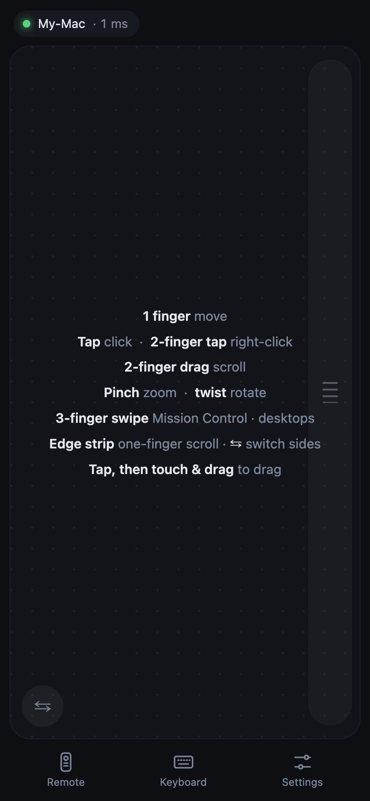
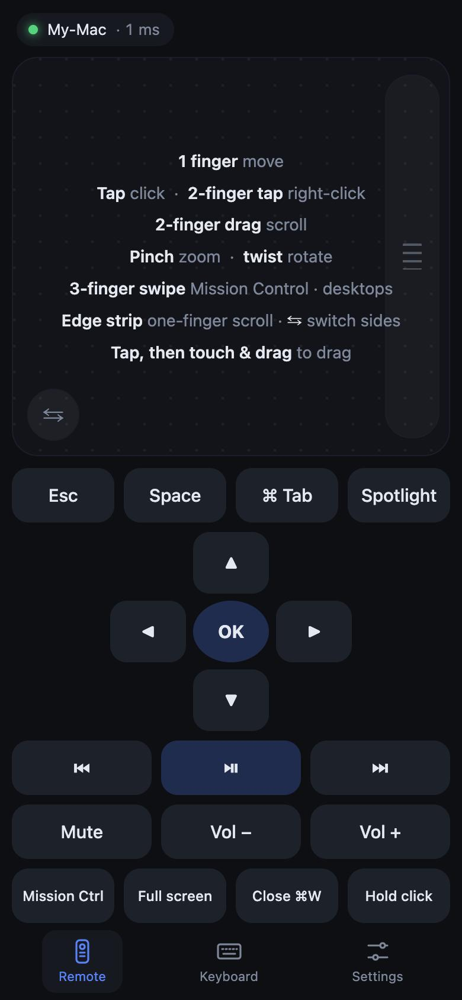
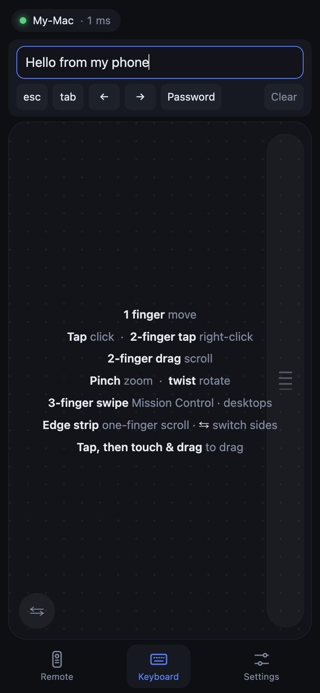
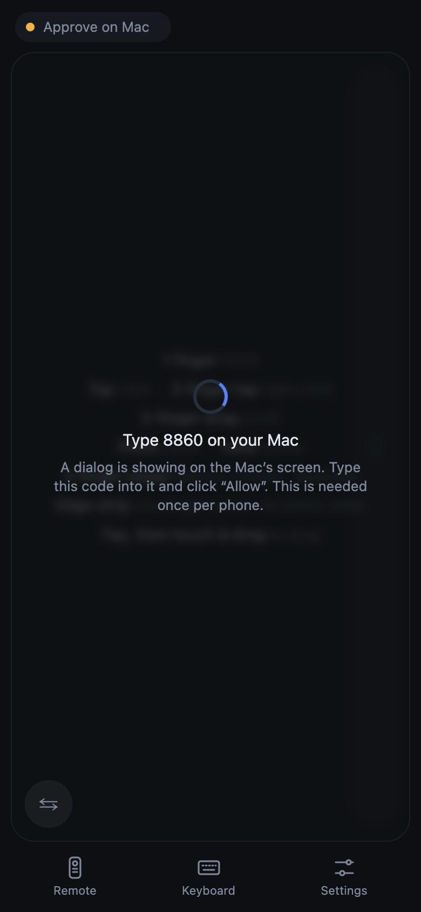

# Mac Touchpad

Use your iPhone as a touchpad and remote for your Mac, which is handy when the Mac is plugged into a TV across the room.

- **Phone:** a web app you add to the Home Screen. It opens full-screen like a native app. Nothing to install from the App Store, no Xcode.
- **Mac:** **Mac Touchpad.app**, a menu bar app (a small Python server inside a signed app bundle). It receives gestures over a local WebSocket and turns them into real cursor movement, clicks, scrolling and key presses (Quartz `CGEvent`).

<p align="center">
  
  
  
  
</p>

| Gesture | Does |
|---|---|
| One-finger drag | Move the cursor (speeds up with faster swipes) |
| Tap | Left click (tap twice quickly for a double-click) |
| Two-finger tap | Right click |
| Two-finger drag | Scroll like a trackpad: momentum when you flick, elastic edges, swipe between pages in Safari/Chrome |
| Pinch with two fingers | Zoom in / out (real pinch-zoom: Safari, Maps, Preview, Photos…) |
| Twist two fingers | Rotate (Preview, Photos, Maps) |
| One finger on the edge strip | Scroll with one thumb. A tap there still clicks. Switching hands? Tap **⇆** in the opposite bottom corner, or hold your thumb still on the empty opposite edge for half a second, and the strip jumps to that side (turn it off in Settings) |
| Tap, then touch & drag | Click-and-drag (move windows, select text) |
| Three-finger swipe up / down | Mission Control / App windows |
| Three-finger swipe left / right | Previous / next desktop or full-screen app |
| Three-finger tap | Look up (dictionary, data detectors) |
| Four-finger swipe | Same as three-finger swipe |
| Four-finger spread | Show Desktop |

The **Remote** tab adds arrows/OK, Esc, Space, play/pause, previous/next, volume, mute, Spotlight, ⌘Tab, Mission Control, full screen, ⌘W and a "Hold click" latch. The **Keyboard** tab opens a text box with the iPhone keyboard: what you type appears on the Mac as you go, including autocorrect and predictive-text fixes (turn Autocorrect off in Settings if you prefer). Return sends Return and starts a fresh box; **Clear** empties the box without touching the Mac.

---

## Setup (about 10 minutes, once)

You need:
- an **Apple Silicon Mac** (M1 or later) with **macOS 15** or later. The build script doesn't support Intel Macs yet.
- **Homebrew's Python 3.13**: `brew install python@3.13`
- **Xcode or its Command Line Tools**, for `clang` and `codesign`: `xcode-select --install`
- an **iPhone on the same Wi-Fi** as the Mac

No Apple Developer account is needed.

### 1. Build and install the Mac app

```bash
git clone https://github.com/christianbarrera/mac-touchpad.git
cd mac-touchpad
tools/setup_signing.sh                          # once: a signing certificate in its own locked keychain
tools/build_app.sh                              # build, sign, install /Applications/Mac Touchpad.app
./touchpad install-agent --allow-when-locked    # start it at login, and now (the flag is optional, see step 5)
```

- **`setup_signing.sh`** makes a self-signed code-signing certificate ("Mac Touchpad Code Signing", valid 10 years, no Apple account) inside a separate keychain and asks you to choose that keychain's password. macOS ties the app's Accessibility permission and its keychain access to this certificate, so the key stays locked except while a build is signing. The keychain also locks itself after 5 idle minutes and when the Mac sleeps, and it isn't on the keychain search list.
- **`build_app.sh`** asks for that keychain password once (signing), then for your Mac password (sudo, to install the app owned by root so nothing running as you can change its code). The first run also creates a Python environment in `.venv` with exact, hash-checked package versions from `requirements.txt`; the app bundles its own copy of Python and those packages, so it doesn't depend on Homebrew, `.venv` or this folder at run time.
- **`install-agent`** adds the app as a login item (`~/Library/LaunchAgents/local.mac-touchpad.plist`, restarted automatically if it ever crashes) and starts it. A **Mac Touchpad** icon appears in the menu bar.

**Trusted networks:** the app only listens on networks you've approved, so it stays silent in cafés, hotels and offices. `install-agent` asks *"Should this network be trusted?"*; answer **y** only on your own network. On an untrusted network the menu offers **Trust This Network…**. You can manage the list later:

```bash
./touchpad trust-network      # trust the network you're on now
./touchpad networks           # list them
./touchpad untrust-network <id>|all
```

macOS hides Wi-Fi names from background apps without Location access, so networks are recognized by their DHCP details (router, DHCP server, subnet, domain). That keeps the server quiet on other networks, but it won't stop someone who deliberately clones your network.

`./touchpad url` prints the phone URLs, a QR code and the certificate fingerprint (the app writes the same to its log, `./touchpad log`):

```
  Phone already set up? Open:          https://Your-Mac.local:8766/ab12cd34/
  New phone (or old http:// icon): open the setup page first,
  it installs this Mac's certificate:
  On your iPhone (same Wi-Fi), open:   http://Your-Mac.local:8765/ab12cd34/
  or, if that name doesn't resolve:    http://192.168.1.23:8765/ab12cd34/

  Certificate SHA-256 (check it matches on the phone):
    2E AF 98 AA ...
```

- The app runs over **HTTPS on port 8766**. Port 8765 is plain HTTP and serves only the one-time setup page and certificate profile (never the app). The QR code points at the setup page.
- **Port 8765 is only open while you're adding a phone:** before the first phone is paired, and for 15 minutes after **Pair New Phone…** (or `./touchpad pair`). The rest of the time it is closed.
- The server listens only on the Mac's address on the trusted network, not on other interfaces (hotspot, VPN, a cable to another machine).
- `Your-Mac.local` is your Mac's Bonjour (mDNS) name. It stays the same when your IP changes, so use it for the Home Screen icon.
- The first time a phone connects, macOS asks whether **"Mac Touchpad"** may "accept incoming network connections": click **Allow**, or the phone can't reach it.
- The last part of the path (`ab12cd34`) is a **pairing code**. Without it the server refuses connections, so other people on the same Wi-Fi can't take over your cursor. The code is stored in `~/Library/Application Support/mac-touchpad/token`. `./touchpad url --reset-token` makes a new one (then `./touchpad restart`); old Home Screen icons then stop working.

### 2. Grant Accessibility permission (once)

macOS only lets apps it trusts control the mouse and keyboard. When the app first starts it asks macOS for permission: click **Open System Settings** and turn on **Mac Touchpad** under **Privacy & Security → Accessibility**. Until you do, the menu bar icon shows a warning triangle and the menu says *Needs Accessibility permission* (with a shortcut to the settings page); the app starts serving by itself as soon as it's granted.

The permission belongs to the signing certificate, not to one build, so rebuilding the app keeps it.

### 3. Set up the secure connection (once per phone)

Scan the QR code with the Camera app, or type the `http://…:8765/…` URL into Safari. The setup page walks you through:

1. **Download profile** → Safari asks to allow a configuration profile: **Allow**.
2. Settings → **Profile Downloaded** → **Install**. "Not Verified" is expected: your Mac made the certificate itself.
3. Settings → General → About → **Certificate Trust Settings** → turn on **Mac Touchpad Local CA**.
4. Back on the setup page it says "This phone trusts the Mac". Tap **Open secure touchpad**.

Before step 2, you can compare the certificate's SHA-256 fingerprint (in the profile's details) with the one the Mac printed. On the semi-trusted Wi-Fi this is what proves you're installing your Mac's certificate and not someone else's.

On first run the Mac creates a small certificate authority in `~/Library/Application Support/mac-touchpad/tls/`. Its private key is kept in the login keychain, readable only by Mac Touchpad.app (when running from source it's a mode-600 file instead). It is restricted to `.local` names and private network addresses, so even if its key leaked it couldn't be used to impersonate real websites on your phone. The server certificate is renewed automatically when the Mac's IP changes. `./touchpad reset-certs` makes a new authority; every phone then has to remove the old profile and run the setup again.

### 4. Add it to the iPhone's Home Screen

On the secure touchpad page (`https://…:8766/…`):

1. Tap **Share**: the square with an up arrow. On iOS 26 it's behind the **"…"** button at the bottom right.
2. Scroll down and tap **Add to Home Screen**. Keep **"Open as Web App"** on, then tap **Add**.

From now on, use the **Touchpad** icon. It opens full-screen with no Safari bars, keeps the screen awake while it's open, and opens instantly even when the Mac is off (it then shows "Looking for your Mac…").

### 5. Pair your phone (once)

Open the Touchpad icon. The phone shows a **4-digit code**, and **a dialog appears on the Mac** naming the device and its network address. Type the code from your phone into the dialog and click **Allow**. If a dialog appears and your phone isn't showing a code, it isn't your phone asking: click **Don't Allow**.

**After the first phone is paired, pairing locks itself.** Nobody else can even make the dialog appear. To add another phone (or re-pair after forgetting one), choose **Pair New Phone…** in the menu (or run `./touchpad pair`). That opens pairing for 2 minutes, for one phone, and the setup page for 15 minutes.

That's it: the phone now holds its own secret key, and the status pill turns green.

**Only paired phones can control the Mac.** Each phone makes its own P-256 key pair. The private half never leaves the phone and can't be read out even by the app's own code; the Mac stores only the public half (`~/Library/Application Support/mac-touchpad/devices.json`), so that file holds nothing that lets anyone pose as your phone. Every connection signs a fresh random challenge. A device without the key gets nowhere, even with the full URL. If you click **Don't Allow**, that address can't ask again for 5 minutes. A notification appears on the Mac whenever a paired phone connects.

**Other safety rules:**
- **Locked Mac:** by default input is ignored while the Mac's screen is locked, so a phone can't type at the lock screen. To unlock the Mac from the phone instead (lid closed, on a TV), tick **Allow Input at the Lock Screen** in the menu (or `./touchpad install-agent --allow-when-locked`). The phone then behaves like a wireless keyboard: whoever holds it still needs your Mac password.
- **Typing passwords:** in the Keyboard tab, tap **Password**. The field is masked, iOS doesn't autocorrect, predict or learn what you type there, and nothing is sent until you press Return (which sends the password followed by Return, then wipes the field). Typed text is never written to the Mac's log.
- **Idle phones:** a phone that sends nothing for 10 minutes is disconnected; touching the app reconnects it. (`--idle-timeout MIN`, 0 = never.)
- **Forgetting a phone** disconnects it within a few seconds, even mid-session.

```bash
./touchpad pair             # allow ONE new phone to pair in the next 2 minutes (menu: Pair New Phone…)
./touchpad devices          # list paired phones (menu: Paired Phones)
./touchpad forget <id>      # unpair one, or: forget all (menu: Paired Phones → Forget…)
./touchpad install-agent --no-pairing   # refuse ALL new pairing requests; only existing phones work
```

Pair from the Home Screen icon, not a Safari tab: iOS gives them separate storage, so each would need its own pairing.

---

## The menu bar app

The icon shows the state: a hand when listening, a filled hand while a phone is connected, a crossed-out hand when off or not listening, and a warning triangle when something needs you. The menu has:

- the status, e.g. *iPhone connected* or *Not listening: untrusted network*
- **Turn Off / Turn On**: stop listening entirely (phones are disconnected) until you turn it back on or the app restarts
- **Pair New Phone…**: same as `./touchpad pair`; shows the setup page address and certificate fingerprint
- **Paired Phones**: each phone with when it was last seen, and **Forget…**
- **Allow Input at the Lock Screen**
- **Trust This Network…** (only on an untrusted network)
- **Open Log**, the version, and **Quit**. A quit app stays quit until the next login. If you reopen it from Applications instead, it runs fine but isn't restarted automatically after a crash; `./touchpad restart` puts it back under the login item.

## Starting and stopping

```bash
./touchpad install-agent    # start at login (and now)
./touchpad uninstall-agent  # remove the login item
./touchpad stop             # stop it until the next login
./touchpad restart          # restart it
./touchpad status           # running? + phone URL
./touchpad log              # follow the log (~/Library/Logs/Mac Touchpad/touchpad.log)
./touchpad url              # print the URL + QR code again
```

### After changing the code

Run `tools/build_app.sh` again. It asks for the signing keychain password and your Mac password, installs the new build and restarts the login item. Accessibility stays granted. A new build has to be allowed to read the certificate authority's key once: right after installing, macOS asks *"Mac Touchpad wants to access key 'Mac Touchpad: certificate authority key'"*. Enter your login password and click **Always Allow** (it applies to that exact build only). The build script triggers this while you're at the keyboard, so it doesn't pop up later on the TV.

For quick experiments you can still run the server straight from this folder: `./touchpad run` (foreground), `./touchpad start` (background, `logs/server.log`) or `./touchpad dry-run`. Stop the app first (`./touchpad stop`), since both use the same ports. Run from a terminal, Accessibility comes from your terminal app, and the CA key in the keychain isn't readable, so the server keeps using the current certificate (and says so if it would need to re-issue it).

### How the app is protected

- **Signed with your own certificate and the hardened runtime.** Accessibility and the keychain item belong to apps signed with that certificate; macOS ignores `DYLD_*` injection into it.
- **Self-contained and isolated.** Python runs embedded in the app's own executable, ignores `PYTHON*` environment variables, the user site directory and the current folder, and loads only libraries inside the bundle or from macOS (the build checks this). Homebrew's library search paths are stripped out.
- **Root-owned in /Applications,** so changing its code needs your admin password. The build script deletes its own signed copy in `build/` after installing, since that copy would carry the same permissions.
- **CA key in the login keychain,** readable without asking only by approved builds of the app. If the app finds a plaintext `ca.key` (left by running from source), it moves the key into the keychain, checks it against the certificate, and only then deletes the file.

What it doesn't protect against: something that learns your login password or the signing keychain password (it could sign its own lookalike app), anything running as admin/root, and edits to `devices.json` (anything running as you could add its own "phone"). The server certificate's private key (`tls/server.key`) is still a mode-600 file.

---

## Settings (gear tab on the phone)

Pointer speed, acceleration, scroll speed, natural scrolling, tap-then-drag on/off, keep screen awake, autocorrect, and an experimental haptic tick. "Keep screen awake" lets the phone sleep after 2 minutes without a touch, so a phone in your pocket can't keep clicking and typing on the Mac. Settings are saved on the phone.

Scrolling follows the Mac's own setting (System Settings → Trackpad → Natural scrolling): the server reports it each time the phone connects. Flip **Natural scrolling** on the phone to choose a direction yourself; **Reset** goes back to following the Mac. (macOS applies its natural-scrolling setting to real trackpads, but not to synthesized events, which is why the phone has to know.)

Three-finger swipes send the keyboard shortcuts for Mission Control (⌃↑), App windows (⌃↓) and switching desktops (⌃← / ⌃→). If one does nothing, check that shortcut is on in System Settings → Keyboard → Keyboard Shortcuts → Mission Control.

## Troubleshooting

- **Stuck on "Connecting…":** check the menu bar status (or `./touchpad log`) for `Not listening: untrusted network` (then **Trust This Network…**). Also check the phone is on the same Wi-Fi (not cellular or a guest network), the app is running, and the macOS firewall allows incoming connections for **Mac Touchpad** (System Settings → Network → Firewall → Options). If `.local` doesn't resolve (some mesh routers block mDNS), use the IP URL.
- **The cursor doesn't move but the status is green:** Accessibility isn't granted to Mac Touchpad (or, when running from source, to your terminal app). See step 2.
- **The menu says "Stopped: … keychain …" or a certificate refresh failed after a rebuild:** the new build wasn't allowed to read the CA key. Run `open -W -n "/Applications/Mac Touchpad.app" --args --check` and click **Always Allow** in the keychain dialog, then `./touchpad restart`.
- **Safari says the connection isn't private:** full trust isn't on (step 3.3), or the phone is using an address the certificate doesn't cover. The certificate covers `Your-Mac.local` and the Mac's private IPs; restart the server if the IP just changed.
- **Port in use:** `./touchpad install-agent --port 9000 --tls-port 9001` (the options become part of the login item).
- **Need the old plain-HTTP behaviour (debugging):** `./touchpad stop`, then `./touchpad run --no-tls`. Everything, including what you type, is then readable by anyone on the network.
- **"Mac is locked" on the phone:** unlock the Mac; input is ignored while it's locked.
- **New phone can't open the setup page:** choose **Pair New Phone…** (or `./touchpad pair`) first. Port 8765 is closed unless you're adding a phone.
- **Test without permission:** `./touchpad dry-run` logs every event instead of injecting it.

**Updates:** the Home Screen app reloads itself into a new version as soon as it notices one (on launch, or whenever it reconnects) and you aren't touching it.

## Known limitations

- **No real haptics.** iOS Safari doesn't support the Vibration API, so taps don't buzz like a real trackpad; feedback is on screen only. The optional "Haptic tick" uses an unofficial iOS 18+ trick (toggling a hidden `<input switch>`). It may give a light tick on taps and remote buttons, or nothing at all, and Apple could remove it at any time.
- No smart zoom (two-finger double-tap), Force Touch, three-finger drag, Notification Center edge swipe or four-finger pinch (Launchpad/Apps).
- Pinch and rotate are sent as the same gesture events a trackpad produces, using fields macOS doesn't document. They work on macOS 26, but a future macOS update could change them.
- The setup page itself is plain HTTP (it has to be: the phone doesn't trust the Mac yet). Someone on the same Wi-Fi could swap in their own profile during setup; checking the fingerprint prevents that.
- Each rebuild of the app needs one **Always Allow** in a keychain dialog before it can use the CA key (the self-signed certificate has no Apple Team ID, so macOS approves builds one by one). See "After changing the code".
- Turn on the macOS firewall (System Settings → Network → Firewall) and allow Mac Touchpad when asked; the server doesn't need any other inbound access.

## How it works

```
iPhone (Safari / Home Screen web app)              Mac
┌───────────────────────────────┐ WSS (TLS 1.2+)┌──────────────────────────┐
│ touch events → accumulators   │ ───────────▶  │ aiohttp (HTTPS+WSS :8766)│
│ requestAnimationFrame: ≤1 move│  JSON, ~60/s  │ → CGEventPost (Quartz)   │
│ + ≤1 scroll message per frame │ ◀───────────  │   mouse / scroll / keys  │
│ ping every 2 s → latency, auto│     pong      │   media keys (NSEvent)   │
│ reconnect with backoff        │               └──────────────────────────┘
└───────────────────────────────┘
```

- **Smoothness:** raw touch events only add to a running delta. One `requestAnimationFrame` loop sends at most one move and one scroll message per frame. If rAF is throttled (e.g. iOS Low Power Mode caps it at 30 fps), the touch handler flushes directly once 24 ms have passed. If the socket backs up, deltas keep merging instead of queueing, so after a Wi-Fi hiccup the cursor jumps to where your finger is rather than replaying a backlog. TCP_NODELAY is set on the server side.
- **Acceleration:** gain = speed × (1 + accel × f(finger speed)). Slow movement stays precise and a quick flick crosses a 1080p screen.
- **Blocking iOS gestures:** `touch-action: none`, `overscroll-behavior: none`, a fixed-position body, `preventDefault()` on touchstart/touchmove (no pull-to-refresh, bounce or edge-swipe-back) and on `gesture*` events (no pinch-zoom), a viewport with `user-scalable=no` and buttons with `touch-action: manipulation` (no double-tap zoom).
- **Reconnect:** exponential backoff (250 ms → 4 s). The app reconnects immediately when it returns to the foreground, after a 6 s silence watchdog, and on `online`/`pageshow` events. iOS often leaves a dead socket that still looks "open" after the app is backgrounded, so the app recycles it.

## Files

```
touchpad                 login item, pairing, devices, networks; run from source (bash)
server/menubar.py        Mac Touchpad.app: menu bar, runs the server in a background thread; --check, --selftest
server/touchpad_server.py  HTTP + WebSocket server (Server class), Accessibility check, URL/QR banner
server/keystore.py       where the CA key lives: login keychain (app) or a mode-600 file; file -> keychain migration
server/input_mac.py      CGEvent mouse/scroll/keyboard/media-key injection
server/devices.py        paired-phone store: public keys + signature check (HMAC for legacy phones)
server/networks.py       trusted-network fingerprint (DHCP details) and store
server/dryrun.py         stand-in for input_mac.py that logs instead of injecting (--dry-run)
server/tls.py            local CA, server certificate, iOS .mobileconfig profile
server/setup.html        plain-HTTP setup page (certificate install steps)
web/hmac.js              SHA-256/HMAC fallback when crypto.subtle is unavailable
web/sw.js                service worker: caches the app shell (HTTPS only)
web/                     the phone app (index.html, app.js, style.css, manifest, icons)
tools/make_icons.py      regenerates the PNG icons (stdlib only)
tools/build_app.sh       builds, signs, self-tests and installs Mac Touchpad.app
tools/launcher.c         the app's main executable: embeds the bundled Python in isolated mode
tools/entitlements.plist hardened-runtime exception (library validation needs a Team ID)
tools/setup_signing.sh   one-time: the signing certificate in its own keychain (uses make_signing_identity.py)
tests/smoke_test.py      end-to-end test (dry-run, throwaway HOME): .venv/bin/python tests/smoke_test.py
docs/DEVELOPMENT.md      architecture, protocol, security model and gotchas, for contributors
```

## Security

Mac Touchpad lets a phone move your cursor and type on your Mac, so read "How the app is protected" and the pairing rules above before you rely on it. If you find a security problem, please report it privately through the repository's **Security** tab ("Report a vulnerability") rather than in a public issue.

## License

[MIT](LICENSE). The software comes with no warranty; see the license for details.

Mac Touchpad is an independent project, not affiliated with or endorsed by Apple Inc. Mac, iPhone, macOS, iOS and Safari are trademarks of Apple Inc.
